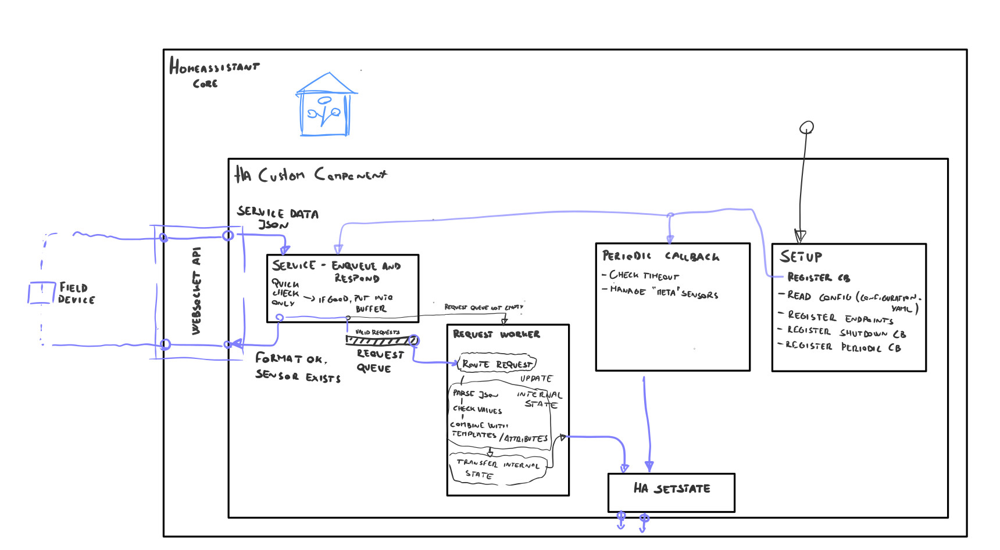

# **gen_websoc** - *Homeassistant Custom Component for recieving data via Websocket*

`gen_websoc` is a lightweight custom bridge for sending bulk sensor readings from a field device to Home Assistant over websocket.

The structure of HA Custom component looks something like this:



## How it works

1. A field device opens a websocket session to Home Assistant.
2. The device sends JSON payloads containing sensor names and values.
3. The custom component validates the structure, enqueues the request, and processes it in the background.
4. The value is stored in the local custom component state for the corresponding sensor.
5. The sensor entity is synchronized with Home Assistant state.
6. If a sensor does not receive updates for a configured timeout, it is marked stale.
7. Optional meta entities can be generated to show device health and status.

In short, the component acts as a bridge between a low-power field sensor and Home Assistant entities without requiring a full MQTT stack.

## About the websocket endpoint and the so called service_data:

The component registers services per device with HAs `homeassistant.components.websocket_api`. The service names follow this pattern:

```yaml
gen_websoc.<device_name>.set_values
```

Then the field devices uses the following format to send data to `gen_websoc` : 
```
json.dumps({"type": "call_service", "domain": ha_websoc_conf.HA_INTEGRATION_DOMAIN, "service": (ha_websoc_conf.HA_SENSOR_INSTANCE_NAME + "." + "set_values"), "service_data": service_data})
```

Example config:

```yaml
gen_websoc:
  - name: fieldy_mc_field_deviceface
    platform: websoc
    en_meta_entity: true
```
where the config values are for this specific example config are:
`ha_websoc_conf.HA_INTEGRATION_DOMAIN  = "gen_websoc"`
`ha_websoc_conf.HA_SENSOR_INSTANCE_NAME = "fieldy_mc_field_deviceface"`

@NOTE: `set_values` is the hardcoded name of the endpoint, hopefully there will be multiple endpoints (services) with different names, could be just a convinience thing, but could also serve different purposes, e.g. dedicated endpoint for when a single entity needs to be set, or when historic data is grouped together and needs to be detangled before sending to HA.

`service_data` is the actual JSON object that contains the measurements, it will be parsed by gen_websoc. in case of service.set_values It should only contain key values that are also defined in `configuration.yaml`

## Why choose websocket?

This design is for field devices that need to send a lot of sensor data quickly and efficiently while spending as little time awake as possible.

Areas where websocket shines:
- Websocket is a good way to transmit large amounts of data in a short time.
- Works well for a custom component that receives bulk JSON, stores it locally, and then updates Home Assistant entities in a controlled way.
- It can avoid some NAT-related problems by using regular web ports instead of a custom MQTT port that may be blocked by an ISP or network policy.
- It is well suited to self-hosted Home Assistant setups where the device can keep a persistent connection to the server.

Downsides:
- It is not a standard Home Assistant integration flow and is more custom and more complex than plain REST-style integrations.
- It requires a custom backend and a small amount of server-side logic.
- It is less flexible than MQTT in terms of routing data to other tools like Grafana or InfluxDB, because the custom component effectively acts as the local broker and state synchronizer.
- It is less user-friendly than a general-purpose integration because the payload format and templating must be defined intentionally.

## Aiming for fast bulk data transmission from field device to server

The priority is to minimize the time spent transferring measurements, because for battery-powered embedded sensors:

*less time spent transferring data*`* -> *more time spent in deep sleep* -> *better battery life*

### Optimized around this idea:
- Keep one websocket session open and reuse it for multiple payloads instead of doing a new handshake for every single sensor update.
- Group multiple values into one payload instead of sending one tiny message per measurement.
- Send only the essentials in the payload: the sensor key and value. The rest of the metadata is defined in Home Assistant config.
- Use a fast queue and deferred processing model so incoming data can be accepted quickly and validated later.
- Keep stale detection and HA state update logic separate from the initial packet validation path.
- Allow entity attributes like icons, units, timeout values, and device class to be preset in configuration instead of repeated in every packet.

## Configuration example

This is the pattern used in the current Home Assistant setup:

```yaml
gen_websoc:
  - name: pweather_ns
    platform: websoc
    en_meta_entity: true
    common_template:
      - name: name_er
        state: null
        friendly_name: null
        icon: mdi:weather-partly-cloudy
        device_class: null
        state_class: measurement
        timeout: "10"
        unit_of_measurement: null

    tag_templates:
      - name: temp
        friendly_name: Temperature
        icon: mdi:thermometer
        device_class: temperature
        unit_of_measurement: "°C"

      - name: humidity
        friendly_name: Humidity
        icon: mdi:water-percent
        device_class: humidity
        unit_of_measurement: "%"

      - name: wind_speed
        friendly_name: Wind Speed
        icon: mdi:weather-windy
        device_class: wind_speed
        unit_of_measurement: "m/s"
```

### Configuration fields

- `name`: the logical name of the field device.
- `platform`: currently expected to be `websoc`.
- `en_meta_entity`: enables generated device-level status entities such as availability and health.
- `common_template`: default metadata used for all sensors unless overridden.
- `tag_templates`: list of sensor definitions, including Name, friendly name, icon, device class, unit, and timeout.

## Behavior and state handling

Genwebsoc does some things automatically:

- validates the incoming request structure
- deduplicates repeated requests by hashed payload content
- updates the in-memory sensor state
- pushes state changes to Home Assistant entities
- marks sensors as stale after their configured timeout
- keeps optional meta entities updated for device health and availability

## Notes on using this integration:

- Keep sensor names short and descriptive - they are sent in the payload but also need to be human readable, because they are used by user when configuring the dashboard, they can be hard to find if there are many entities.
- Define all common attributes in `common_template` to reduce configuration.yaml lenght.
- Use `timeout` values to control how long readings stay valid without incoming data from sensor, before getting set to default value
- Use `en_meta_entity: true` if you want the device itself to show availability and health status in Home Assistant.
- This component is best when the device is the primary producer of data and the server is mainly a collection and presentation layer - so one way communication, incoming data from sensor (though it can be adapted to work both ways).

